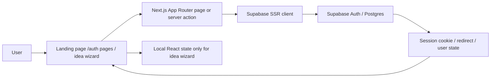
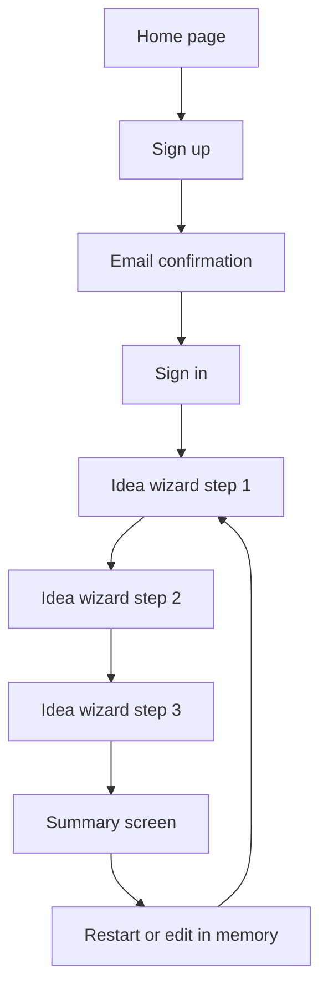
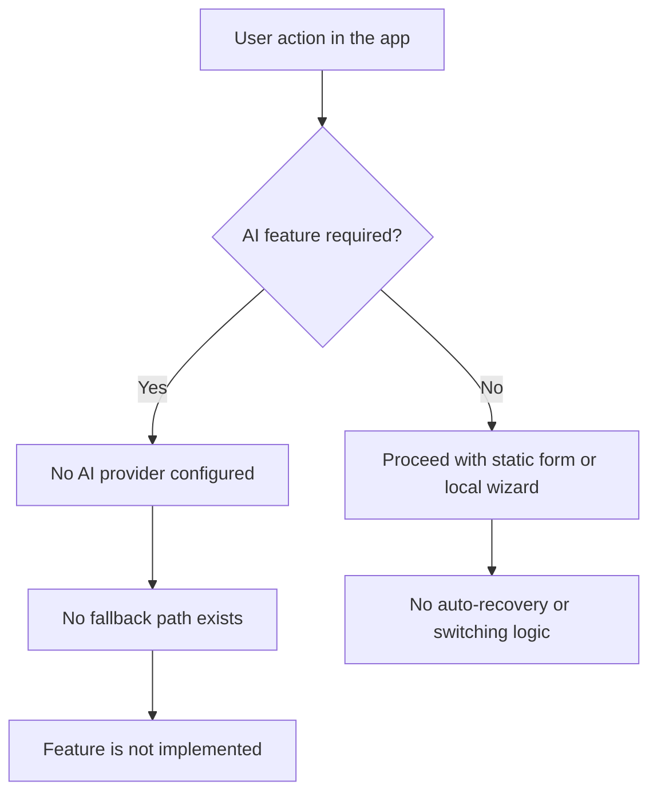
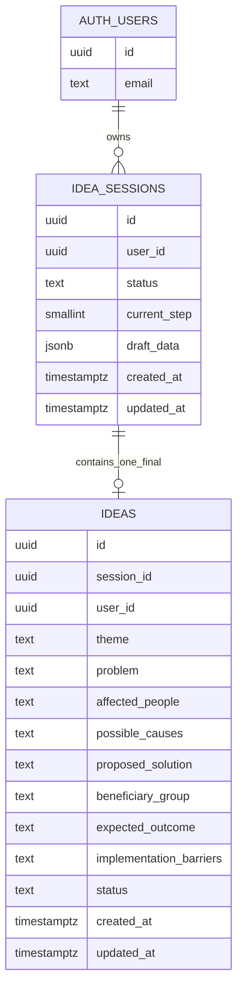
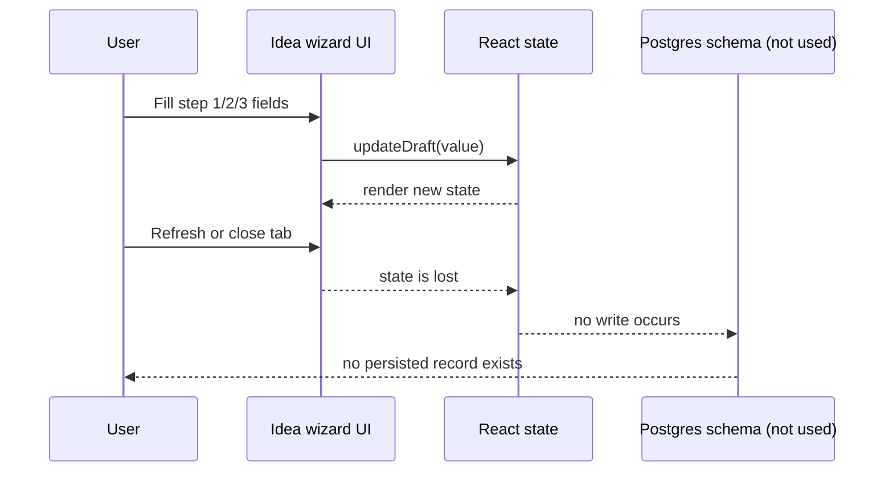
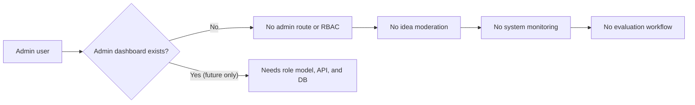

# Technical Audit Report — Javaneh

## SECTION 1 — EXECUTIVE PROJECT OVERVIEW

The repository implements a small, early-stage Persian-language social idea-generation application named "جوانه" (Javaneh), as described in [README.md](../README.md) and the UI in [src/app/page.tsx](../src/app/page.tsx). The stated problem is to help people identify social issues and transform them into actionable ideas, but the current codebase is a partial prototype rather than a complete idea-management platform.

### Current scope

- Public landing page and marketing content for the platform.
- Email/password authentication via Supabase Auth.
- Sign-up, sign-in, password reset, resend confirmation, and sign-out flows.
- A three-step client-side idea wizard that collects a social-theme selection and narrative answers.
- Database schema for `idea_sessions` and `ideas` that appears to be intended for stored draft and submission flows, but it is not connected to the UI.

### Target users

The app is primarily oriented to authenticated individual users who create an account and then work through an idea-development workflow. There are no implemented roles such as expert, evaluator, group representative, or admin in the repository. The only actual role in the database and app is the standard Supabase `authenticated` user role.

### Current development stage

This project is best described as an early MVP prototype and authentication scaffold. It contains the shell of a social innovation workflow, but the core idea-management lifecycle is incomplete. The explicit project docs state that the idea form still holds data only in memory and is not connected to a database, which matches the code reality.

### Technology direction

The project uses a Next.js 16 App Router application with TypeScript, React 19, Tailwind CSS, and Supabase for authentication and database connectivity. The architecture is a server-rendered Next.js app with Supabase SSR clients and server actions for auth. There is no evidence of repository-level API services, background workers, AI services, or an admin dashboard.

### Implementation status summary

Implemented:
- Public landing page.
- Email auth flow with Supabase.
- Callback handling for email confirmation and reset flows.
- Client-side wizard UI for idea steps.
- Database schema and RLS intended for idea persistence.

Not yet implemented or not connected:
- Persistent idea saving.
- Multi-stage project progress persistence.
- AI mentoring or content generation.
- Group management.
- Admin dashboard.
- Thematic classification system.
- Evaluation workflows.

---

## SECTION 2 — TECHNOLOGY STACK

### Frontend

| Category | Actual technology | Evidence | Usage |
| --- | --- | --- | --- |
| Framework | Next.js 16.4.3 | [package.json](../package.json) | App Router, server components, route handling |
| Language | TypeScript 5.x | [package.json](../package.json), [tsconfig.json](../tsconfig.json) | Type-safe app code |
| UI library | React 19.3.0 | [package.json](../package.json) | Component rendering |
| Styling | Tailwind CSS 4 | [package.json](../package.json), [src/app/globals.css](../src/app/globals.css) | Styling and layout |
| Routing | Next.js App Router | [src/app](../src/app) | Pages and route folders |
| State management | React `useState` and server action state | [src/app/ideas/new/idea-wizard.tsx](../src/app/ideas/new/idea-wizard.tsx), [src/app/auth/auth-form.tsx](../src/app/auth/auth-form.tsx) | Local UI state and form actions |
| Form handling | HTML form + `useActionState` | [src/app/auth/auth-form.tsx](../src/app/auth/auth-form.tsx) | Auth submission |
| Validation | Custom functions in TypeScript | [src/lib/supabase/auth-validation.ts](../src/lib/supabase/auth-validation.ts) | Email/password validation |
| Design system | Custom CSS utility classes, no component library | [src/app/page.tsx](../src/app/page.tsx) | Branding and layout |

### Backend

| Category | Actual technology | Evidence | Usage |
| --- | --- | --- | --- |
| Runtime | Node.js via Next.js server | [package.json](../package.json) | App server and route processing |
| API style | Next.js Server Actions + route handlers | [src/app/auth/actions.ts](../src/app/auth/actions.ts), [src/app/auth/callback/route.ts](../src/app/auth/callback/route.ts) | Auth operations |
| Server-side architecture | App Router server components and route handlers | [src/app](../src/app) | SSR and auth logic |
| Middleware/proxy | `@supabase/ssr` proxy for session cookie refresh | [src/proxy.ts](../src/proxy.ts) | Session cookie management |
| Background jobs | None | repository search | No queue, cron, or worker implementation |

### Database and storage

| Category | Actual technology | Evidence | Usage |
| --- | --- | --- | --- |
| Database provider | Supabase Postgres | [supabase/migrations/20261024090000_initial_idea_schema.sql](../supabase/migrations/20261024090000_initial_idea_schema.sql) | Intended data model |
| DB engine | PostgreSQL | migration SQL | `uuid`, `jsonb`, `timestamptz`, triggers, RLS |
| DB access library | `@supabase/ssr` and `@supabase/supabase-js` | [package.json](../package.json), [src/lib/supabase/server.ts](../src/lib/supabase/server.ts) | Session-aware DB access |
| Authentication provider | Supabase Auth | [src/app/auth/actions.ts](../src/app/auth/actions.ts) and README | email/password auth |
| Storage | None implemented | repository inspection | No file storage API or uploads |
| Data access strategy | Server-verified identity + RLS in SQL | [supabase/migrations/20261024090000_initial_idea_schema.sql](../supabase/migrations/20261024090000_initial_idea_schema.sql) | Intended secure access model |

### AI infrastructure

There is no actual AI infrastructure implemented in the current repository. No AI provider SDK, no model configuration, no prompt templates, no structured-output parser, and no AI endpoint were found in the active codebase. The repository therefore does not contain a working AI mentoring, evaluation, or classification system.

### Deployment and development

| Category | Actual technology | Evidence | Usage |
| --- | --- | --- | --- |
| Hosting | Local Next.js development environment; no deployment config detected | [package.json](../package.json), [README.md](../README.md) | Dev app only |
| Version control | Git | repo state | Branch `main`, working tree changes present |
| Packages | npm | [package.json](../package.json) | Dependency management |
| Build | `next build` | [package.json](../package.json) | Application build |
| Linting | ESLint | [package.json](../package.json) | Code quality checks |
| CI/CD | None detected | repo inspection | No GitHub Actions or deployment workflow found |

---

## SECTION 3 — COMPLETE PROJECT DIRECTORY STRUCTURE

Repository structure (important directories only):

```text
.
├── AGENTS.md
├── README.md
├── .env.example
├── .gitignore
├── next.config.ts
├── next-env.d.ts
├── package.json
├── package-lock.json
├── public/
├── report/
├── src/
│   ├── app/
│   │   ├── auth/
│   │   │   ├── actions.ts
│   │   │   ├── auth-form.tsx
│   │   │   ├── auth-notice.tsx
│   │   │   ├── callback/
│   │   │   ├── confirmed/
│   │   │   ├── forgot-password/
│   │   │   ├── layout.tsx
│   │   │   ├── link-error/
│   │   │   ├── resend-confirmation/
│   │   │   ├── sign-in/
│   │   │   ├── sign-out/
│   │   │   ├── sign-up/
│   │   │   └── update-password/
│   │   ├── globals.css
│   │   ├── ideas/
│   │   │   └── new/
│   │   ├── layout.tsx
│   │   └── page.tsx
│   ├── lib/
│   │   └── supabase/
│   │       ├── auth-validation.ts
│   │       ├── auth.ts
│   │       ├── client.ts
│   │       ├── env.ts
│   │       └── server.ts
│   └── proxy.ts
├── supabase/
│   ├── README.md
│   ├── config.toml
│   ├── migrations/
│   │   ├── 20261024090000_initial_idea_schema.sql
│   │   └── 20261024090800_revoke_service_role_idea_access.sql
│   └── tests/
│       └── database/
│           └── idea_rls_test.sql
├── tests/
│   └── auth-validation.test.mjs
└── tsconfig.json
```

### Directory purpose and usage

- [src/app](../src/app): Main application routes and page components.
- [src/app/auth](../src/app/auth): Authentication UI, server actions, and callback flow.
- [src/app/ideas/new](../src/app/ideas/new): The idea wizard for the social problem-to-idea flow.
- [src/lib/supabase](../src/lib/supabase): Shared Supabase configuration, validation, user retrieval, and session logic.
- [src/proxy.ts](../src/proxy.ts): SSO session proxy to refresh Auth cookies in Next.js.
- [supabase/migrations](../supabase/migrations): Persistent database schema and security adjustments.
- [supabase/tests/database](../supabase/tests/database): RLS and authorization tests.
- [tests](../tests): Application-level validation tests for auth logic.
- [report](../report): Audit output directory; current report is created here.

### Main entry points

- [src/app/page.tsx](../src/app/page.tsx): Landing page.
- [src/app/auth/sign-up/page.tsx](../src/app/auth/sign-up/page.tsx): Registration UI.
- [src/app/auth/sign-in/page.tsx](../src/app/auth/sign-in/page.tsx): Login UI.
- [src/app/ideas/new/page.tsx](../src/app/ideas/new/page.tsx): Idea wizard entry page.

---

## SECTION 4 — CURRENT SYSTEM ARCHITECTURE

### 1. Frontend architecture

The frontend is a Next.js App Router application with a Persian UI focused on a landing page and a public idea wizard. The design pattern is simple and mostly page-based rather than component-heavy data-driven architecture. Templates rely on inline class-based styling with Tailwind CSS and are not built around a formal design system or state store.

### 2. Backend architecture

The application does not include a separate backend service or REST API layer. Instead it uses:
- Server components and route handlers under [src/app](../src/app)
- Server actions in [src/app/auth/actions.ts](../src/app/auth/actions.ts)
- Supabase Auth for identity and session management
- A small Next.js proxy for session refresh in [src/proxy.ts](../src/proxy.ts)

This is an app-server architecture rather than a dedicated monolithic API plus UI split.

### 3. Database architecture

The intended persistence layer exists as PostgreSQL schema in [supabase/migrations/20261024090000_initial_idea_schema.sql](../supabase/migrations/20261024090000_initial_idea_schema.sql). The architecture uses:
- `idea_sessions` for draft state and step tracking
- `ideas` for finalized submission data
- RLS policies for authenticated user-only access
- Triggers to sync session state and `updated_at` timestamps

However, the current runtime does not connect the idea wizard to these tables; the database layer is implemented but not wired into the app workflow.

### 4. AI integration architecture

No AI architecture exists. The app does not call an AI provider, pass context, store conversation data, or use model-based prompting. This is a critical architectural finding.

### 5. Authentication architecture

Authentication is handled by Supabase Auth, accessed through `@supabase/ssr` server clients. The flow is:
- User enters email/password in a form.
- Form server action calls `supabase.auth.signUp`, `signInWithPassword`, `resetPasswordForEmail`, or `resend`.
- PKCE callback route exchanges the code at `/auth/callback`.
- Redirect points are limited by `getAuthRedirectPath()` to `/auth/confirmed` or `/auth/update-password`.

### 6. File storage architecture

No file upload or object storage implementation exists. The application does not store files or attachments.

### 7. External service integrations

Current external service integration is limited to Supabase Auth and the PostgreSQL database. No payment, AI, email service aside from Supabase Auth email delivery, or analytics provider is configured.

### 8. Request lifecycle



This is the actual current lifecycle for the idea wizard: user input is stored in `useState`, not in database.

### Architectural patterns

The project currently uses a hybrid pattern:
- client-side React UI
- server-side Next.js rendering and auth actions
- database-first schema in SQL for future persistence
- no independent backend service layer

This is a lightweight, mostly frontend-driven app scaffold with a database schema prepared for more serious persistence but not yet operationalized.

---

## SECTION 5 — USER ROLES AND PERMISSION SYSTEM

### Implemented roles

The repository does not implement user roles beyond the standard Supabase `authenticated` user role. There are no tables for groups, admins, experts, evaluators, or organizations. The only authorization boundary is database-level ownership enforced by RLS for authenticated users.

### User registration and authentication

Registration and login are implemented in:
- [src/app/auth/sign-up/page.tsx](../src/app/auth/sign-up/page.tsx)
- [src/app/auth/sign-in/page.tsx](../src/app/auth/sign-in/page.tsx)
- [src/app/auth/actions.ts](../src/app/auth/actions.ts)
- [src/app/auth/callback/route.ts](../src/app/auth/callback/route.ts)

Behavior:
- `signUp` validates the email and password and checks both password fields match.
- A Supabase Auth sign-up request is sent with `emailRedirectTo` to `/auth/confirmed`.
- The app requires the user to confirm email before full account use.
- `signIn` checks credentials and redirects to `/ideas/new`.
- `requestPasswordReset` sends an email reset flow.
- `updatePassword` sets the new password only for a valid reset session.

### Session management

- Session cookies are managed by Supabase SSR.
- `src/proxy.ts` refreshes session claims with `auth.getClaims()`.
- User identity is checked with `auth.getUser()` in server-only code.

### Permissions and authorization enforcement

The app uses two layers:
1. UI gating: some pages are linked and displayed to users, but this does not constitute security.
2. Server + DB enforcement: Supabase Auth plus RLS in the SQL schema.

The actual SQL protects access to `idea_sessions` and `ideas` by owner identity.

### Role-permission matrix

| Role | Implemented | Auth path | Main permissions | Evidence |
| --- | --- | --- | --- | --- |
| Unauthenticated user | Yes | /auth/sign-up, /auth/sign-in | access public pages and auth | [src/app/page.tsx](../src/app/page.tsx) |
| Authenticated user | Yes | /ideas/new | can create/own draft-like session conceptually; not yet wired in UI | [supabase/migrations/20261024090000_initial_idea_schema.sql](../supabase/migrations/20261024090000_initial_idea_schema.sql) |
| Admin | No | None | None implemented | repository inspection |
| Expert/evaluator | No | None | None implemented | repository inspection |
| Group user or organization | No | None | None implemented | repository inspection |

### Authorization gaps

- No server-side permission checks around `/ideas/new` beyond redirecting to auth.
- No admin boundaries.
- No concept of expert or reviewer.
- No route-level RBAC beyond session existence.
- No database records for user profile metadata beyond Supabase Auth accounts.

---

## SECTION 6 — COMPLETE USER JOURNEY AND APPLICATION WORKFLOWS

The current user journey is a public landing page followed by auth and a local three-step idea wizard. There are no deeper multi-tenant or group workflows in the current code.

### Step 1 — Public landing page
- Purpose: explain the concept of the platform and route users to sign-up or idea creation.
- UI: [src/app/page.tsx](../src/app/page.tsx)
- Fields: none
- Validation: none
- Backend: none
- Database: none
- AI: none
- Output: navigation to auth or wizard

### Step 2 — User registration
- Purpose: create a user account with email/password.
- UI: [src/app/auth/sign-up/page.tsx](../src/app/auth/sign-up/page.tsx)
- Inputs: email, password, confirm password
- Validation: `normalizeEmail`, `isValidEmail`, `isValidPassword`
- Backend: `signUp` in [src/app/auth/actions.ts](../src/app/auth/actions.ts)
- Database: Supabase Auth users table
- AI: none
- Completion: Supabase sends verification email and user receives confirmation flow

### Step 3 — Email confirmation
- Purpose: verify identity.
- UI: [src/app/auth/callback/route.ts](../src/app/auth/callback/route.ts), [src/app/auth/confirmed/page.tsx](../src/app/auth/confirmed/page.tsx)
- Inputs: PKCE code from Supabase Auth
- Validation: redirect allow-list and code exchange
- Backend: `exchangeCodeForSession`
- Database: Auth schema only
- AI: none
- Completion: redirect to `/auth/confirmed`

### Step 4 — Sign-in
- Purpose: authenticate an already confirmed user.
- UI: [src/app/auth/sign-in/page.tsx](../src/app/auth/sign-in/page.tsx)
- Inputs: email, password
- Validation: length and email format checks
- Backend: `signIn` server action
- Database: Auth schema only
- AI: none
- Completion: redirect to `/ideas/new`

### Step 5 — Idea wizard
- Purpose: collect a social problem statement and a proposed idea.
- UI: [src/app/ideas/new/idea-wizard.tsx](../src/app/ideas/new/idea-wizard.tsx)
- Inputs: problem theme, problem description, affected people, causes, solution, beneficiary group, expected outcome, barriers
- Validation: required fields for each step; navigation buttons disable until required entries are present
- Backend: none; all state is local React `useState`
- Database: no app queries, only intended schema in SQL
- AI: none
- Completion: shows final summary and allows restart/edit, but no submit persists data
- Persistence: not stored after refresh; README explicitly says so

### Step 6 — Final summary
- Purpose: display what the user entered.
- UI: `CompletionSummary` in [src/app/ideas/new/idea-wizard.tsx](../src/app/ideas/new/idea-wizard.tsx)
- Output: summary card list
- Database: none
- Completion condition: all required fields filled

### Journey status

The application supports:
- Registration: Yes
- Email confirmation: Yes
- Sign-in: Yes
- Idea wizard progression: Yes
- Draft saving: No
- Editing previous answers: Yes, in the in-memory wizard only
- Completing a submission: Only a visual summary exists; no persistence submission function
- Resuming interrupted sessions: No
- Tracking progress across refreshes: No



---

## SECTION 7 — AI INTEGRATION AND MENTORING SYSTEM

There is no implemented AI mentoring system in the repository. The actual code does not contain any AI model integration, prompt management, conversation store, or LLM-generated content workflow.

### Verified status

- No provider SDKs such as OpenAI, Anthropic, or Gemini are present in [package.json](../package.json).
- No model names or endpoints are defined in source code.
- No `fetch()` calls are made to AI APIs in the app.
- No prompt templates or system instructions are defined.
- No conversation tables or message tables exist in the database schema.

### Actual behavior of the app

The idea-generation flow is not an AI mentor or chatbot. It is a purely static, client-side form wizard. The app asks the user to answer structured questions, but it does not generate coaching questions, critique ideas, or propose alternate solutions.

### AI limitations and dependencies

Because no AI layer exists, the following are not implemented:
- contextual guidance
- curiosity-driven questioning
- automatic idea evaluation
- response formatting or classification
- retry logic, token control, cost tracking, or model fallback

This project does not yet have an AI dependency chain or production AI reliability surface.



---

## SECTION 8 — AI FAILURE HANDLING AND STATIC FALLBACK

There is no AI system to fail, and there is therefore no AI fallback mechanism. The repository also does not implement a static registration form that is designed to replace an AI-driven onboarding flow.

### Fallback and resilience status

| Area | Status | Evidence |
| --- | --- | --- |
| AI provider present | No | package manifest and repo search |
| Static registration form as AI fallback | Not implemented as a fallback | [src/app/auth](../src/app/auth) |
| User can continue after AI outage | Not applicable | No AI layer exists |
| Dynamic switching between AI and static mode | No | repository inspection |
| Recovery of incomplete submissions | No | local `useState` only |

The idea wizard is not a fallback system for AI; it is simply the main application UX for idea entry. There is no automatic detection or recovery path because no AI integration exists.

---

## SECTION 9 — DATABASE ARCHITECTURE AND DATA MODEL

### Database overview

The active schema is defined in [supabase/migrations/20261024090000_initial_idea_schema.sql](../supabase/migrations/20261024090000_initial_idea_schema.sql). It introduces two core tables and a trigger-based synchronization layer.

### Table 1: public.idea_sessions

| Column | Type | Constraints | Notes |
| --- | --- | --- | --- |
| `id` | `uuid` | PK, default `gen_random_uuid()` | Session identifier |
| `user_id` | `uuid` | NOT NULL, FK to `auth.users(id)`, ON DELETE CASCADE | Session owner |
| `status` | `text` | NOT NULL default `'in_progress'`, check values `'in_progress'`, `'submitted'` | Session state |
| `current_step` | `smallint` | NOT NULL default `1`, check 1 to 3 | Wizard stage |
| `draft_data` | `jsonb` | NOT NULL default `'{}'::jsonb`, object check | Partial draft payload |
| `created_at` | `timestamptz` | NOT NULL default `now()` | Creation timestamp |
| `updated_at` | `timestamptz` | NOT NULL default `now()` | Updated timestamp |

Unique and index constraints:
- Unique tuple `(id, user_id)`
- Index on `user_id`

### Table 2: public.ideas

| Column | Type | Constraints | Notes |
| --- | --- | --- | --- |
| `id` | `uuid` | PK, generated uuid | Finalized idea record |
| `session_id` | `uuid` | NOT NULL, UNIQUE, FK to session | only one idea per session |
| `user_id` | `uuid` | NOT NULL, FK to `auth.users(id)` | owner |
| `theme` | `text` | NOT NULL, non-empty check | idea theme |
| `problem` | `text` | NOT NULL, non-empty check | issue description |
| `affected_people` | `text` | NOT NULL, non-empty check | affected audience |
| `possible_causes` | `text` | NOT NULL, non-empty check | root-cause hypothesis |
| `proposed_solution` | `text` | NOT NULL, non-empty check | proposed solution |
| `beneficiary_group` | `text` | NOT NULL, non-empty check | target beneficiaries |
| `expected_outcome` | `text` | NOT NULL, non-empty check | expected change |
| `implementation_barriers` | `text` | NOT NULL, non-empty check | execution obstacles |
| `status` | `text` | default `'submitted'`, check `'submitted'`, `'archived'` | idea status |
| `created_at` | `timestamptz` | default `now()` | creation |
| `updated_at` | `timestamptz` | default `now()` | update |

Index:
- Index on `user_id`

### Trigger logic and data integrity

The migration defines:
- `public.set_updated_at()` to update `updated_at`
- `public.sync_idea_session_status()` security-definer trigger to set session status when an idea is inserted/deleted
- `AFTER INSERT` and `AFTER DELETE` triggers on `ideas`

This logic ensures:
- an inserted idea moves an owned session from `in_progress` to `submitted`
- deleting an idea reopens the session to `in_progress`
- the session cannot be reopened if an idea already exists in the invalid state

### Row Level Security

RLS is enabled on both tables. Policies ensure that authenticated users can only access their own rows. The follow-up migration [supabase/migrations/20261024090800_revoke_service_role_idea_access.sql](../supabase/migrations/20261024090800_revoke_service_role_idea_access.sql) removes `service_role` grants on these tables.

### Current status of the schema

The schema appears to be a designed future state for the idea workflow, but it is not yet integrated with the runtime application. There are no app routes that actually insert or read from `idea_sessions` and `ideas` in the current Next.js code.

### ER diagram



---

## SECTION 10 — DATA PERSISTENCE AND INTERNET INTERRUPTION

The current implementation does not persist idea data or draft contents across requests or browser refreshes.

### What is actually implemented

- The idea wizard stores data in React `useState` in [src/app/ideas/new/idea-wizard.tsx](../src/app/ideas/new/idea-wizard.tsx).
- The page explicitly says: "In this version, the answers are cleared when the page is closed or refreshed."
- There is no `localStorage`, `IndexedDB`, or autosave API.
- There is no retry mechanism for interrupted submissions.
- There is no database submission flow.

### Persistence design status

| Capability | Status | Evidence |
| --- | --- | --- |
| Immediate save | No | `useState` only |
| Autosave | No | no local storage or debounce logic |
| Local draft store | No | no IndexedDB/localStorage |
| Browser persistence | No | forms reset on refresh |
| Interrupted request retry | No | no network queue |
| Duplicate prevention | Not implemented in runtime | no DB insert path |
| Version history | No | no revision table |
| Recovery after interruption | No | no persisted draft |

### Risks

- User input can be lost by refresh, browser close, or tab crash.
- Because the wizard does not submit to the database, there is no durable record of any idea.
- The schema suggests a future solution, but current behavior is not resilient to interruption.



---

## SECTION 11 — AUTOMATIC THEMATIC CLASSIFICATION

No automatic thematic classification exists in the current implementation.

### Actual status

- The initial landing page includes fixed theme labels but they are static UI values, not persisted classification categories.
- There are no classification services, no AI calls, and no `theme`-mapping tables.
- The database schema does not contain thematic axes, categories, or classification confidence columns.
- There are no admin endpoints to change classifications.

### Verified facts

The only theme-related strings are examples like:
- "کیفیت زندگی شهری"
- "آموزش و فرصت برابر"
- "سلامت و رفاه اجتماعی"
- "محیط زیست و پایداری"

Those values appear in the UI and are not stored as a formal taxonomy in the database. No configurable six-axis system exists in the repo.

---

## SECTION 12 — ADMINISTRATIVE DASHBOARD

No administrative dashboard exists in the repository.

### What is missing

- No `/admin` or equivalent route.
- No dashboard pages.
- No user management API.
- No idea administration workflow.
- No evaluation management screens.
- No AI monitoring or service logs.
- No configuration console.

### Actual status

The current app is limited to public landing, auth, and a one-user idea wizard. There is no admin role, no admin table, no authorized endpoints, and no server code that exposes management functionality.



---

## SECTION 13 — API INVENTORY

The project uses Next.js server actions and route handlers instead of a conventional REST API. There are no independent backend endpoints for idea submission or admin functions.

### Authentication and account endpoints

| Method | Route | Purpose | Auth required | Evidence |
| --- | --- | --- | --- | --- |
| GET | `/auth/callback` | exchange PKCE code for session | No, but valid code is required | [src/app/auth/callback/route.ts](../src/app/auth/callback/route.ts) |
| GET | `/auth/confirmed` | show confirmation status page | Optional, session checked | [src/app/auth/confirmed/page.tsx](../src/app/auth/confirmed/page.tsx) |
| GET | `/auth/link-error` | show invalid callback state | No | [src/app/auth/link-error/page.tsx](../src/app/auth/link-error/page.tsx) |
| POST (server action) | `/auth/sign-up` | create account via email/password | No | [src/app/auth/actions.ts](../src/app/auth/actions.ts) |
| POST (server action) | `/auth/sign-in` | authenticate user | No | [src/app/auth/actions.ts](../src/app/auth/actions.ts) |
| POST (server action) | `/auth/forgot-password` | request reset email | No | [src/app/auth/actions.ts](../src/app/auth/actions.ts) |
| POST (server action) | `/auth/resend-confirmation` | send sign-up confirmation email | No | [src/app/auth/actions.ts](../src/app/auth/actions.ts) |
| POST (server action) | `/auth/update-password` | set new password | Yes, valid user session | [src/app/auth/actions.ts](../src/app/auth/actions.ts) |
| POST (server action) | `/auth/sign-out` | delete local session | Yes | [src/app/auth/actions.ts](../src/app/auth/actions.ts) |

### Public and UX routes

| Method | Route | Purpose | Auth required | Evidence |
| --- | --- | --- | --- | --- |
| GET | `/` | landing page | No | [src/app/page.tsx](../src/app/page.tsx) |
| GET | `/ideas/new` | idea wizard page | Likely yes from UX flow, but no server-side access check | [src/app/ideas/new/page.tsx](../src/app/ideas/new/page.tsx) |

### Middleware/proxy behavior

- [src/proxy.ts](../src/proxy.ts) is not a user-facing API; it refreshes cookies and validates claims for app requests.

### API inventory conclusion

There is no current REST API for idea submission, versioning, evaluation, classification, or admin functions. The project relies on route handlers and server actions only for auth.

---

## SECTION 14 — FRONTEND AND UI IMPLEMENTATION

### Main pages

- [src/app/page.tsx](../src/app/page.tsx): marketing/landing page with hero, process section, and theme preview
- [src/app/auth/sign-up/page.tsx](../src/app/auth/sign-up/page.tsx): registration page
- [src/app/auth/sign-in/page.tsx](../src/app/auth/sign-in/page.tsx): sign-in page
- [src/app/auth/forgot-password/page.tsx](../src/app/auth/forgot-password/page.tsx): reset request form
- [src/app/auth/update-password/page.tsx](../src/app/auth/update-password/page.tsx): password change form
- [src/app/ideas/new/page.tsx](../src/app/ideas/new/page.tsx): wizard entry page

### Shared components and layout

- [src/app/layout.tsx](../src/app/layout.tsx): root layout and global metadata
- [src/app/auth/layout.tsx](../src/app/auth/layout.tsx): auth shell layout
- [src/app/auth/auth-form.tsx](../src/app/auth/auth-form.tsx): reusable auth form component
- [src/app/auth/auth-notice.tsx](../src/app/auth/auth-notice.tsx): generic status and CTA notice
- [src/app/ideas/new/idea-wizard.tsx](../src/app/ideas/new/idea-wizard.tsx): the most substantial UI component

### Styling and design conventions

- Tailwind CSS utility classes dominate the UI.
- Real design tokens are custom hex colors and layout spacing values; there is no central theme file.
- The app is fully Persian RTL-oriented (`dir="rtl"`, `lang="fa"`).
- There is no formal component library or design system beyond custom classes.

### Responsive behavior

The layout uses responsive classes (`sm:`, `md:`, `lg:`) and max-width containers, indicating the app is designed for mobile and desktop responsiveness. No deeper accessibility auditing was found beyond semantic headings and `aria-*` attributes on forms.

### UI quality observations

Good:
- The landing page is polished and consistent.
- The auth flow is cleanly grouped.
- The wizard is structured into steps and has explicit progress pills.

Gaps:
- The wizard is only client state, not persisted.
- The app has no dashboards or data tables.
- There is no shared data model between UI and database.

---

## SECTION 15 — SECURITY AUDIT

### Authentication and authorization

Security is partially implemented.

Verified:
- Supabase Auth is used for account management.
- Public environment variables are limited to `NEXT_PUBLIC_*` values in [src/lib/supabase/env.ts](../src/lib/supabase/env.ts).
- `getAuthRedirectPath()` restricts callback destinations to two internal paths in [src/lib/supabase/auth-validation.ts](../src/lib/supabase/auth-validation.ts).
- The database schema uses RLS and ownership checks in [supabase/migrations/20261024090000_initial_idea_schema.sql](../supabase/migrations/20261024090000_initial_idea_schema.sql).

Potential gaps:
- No server-side admin check exists because no admin role is implemented.
- The app does not enforce auth on `/ideas/new` via server-side logic; the route is a public page that is likely wired from UX rather than server authorization.
- There is no route guard for authenticated-only private flows except the app’s intended navigation flow.

### Environment and secret handling

- The repository uses `.env.example` as a template at [\.env.example](../.env.example).
- The app expects `NEXT_PUBLIC_SUPABASE_URL`, `NEXT_PUBLIC_SUPABASE_PUBLISHABLE_KEY`, and `NEXT_PUBLIC_SITE_URL`.
- No secrets are intentionally checked into source control in the repository structure shown here.
- This report does not include any actual secret values.

### Input validation and web security

- Email validation and password length rules exist in [src/lib/supabase/auth-validation.ts](../src/lib/supabase/auth-validation.ts).
- Password confirm validation happens in the client side at [src/app/auth/auth-form.tsx](../src/app/auth/auth-form.tsx).
- The app is not handling file uploads, so file-upload attack vectors are not present.
- React escapes user text in normal rendering, reducing a direct XSS risk in the UI for text boxes.

### Confirmed vs potential risks

Confirmed:
- The project is intentionally designed to use only public Supabase credentials; no `service_role` secret appears in the application code.
- Data model security is planned but not fully applied operationally in the current UI.

Potential but not confirmed:
- Because no admin role exists, there is no tested admin hardening surface.
- The app’s idea wizard stores text in browser memory only, which is lower-risk than a DB compromise but still not durable.

---

## SECTION 16 — PERFORMANCE AND OPTIMIZATION AUDIT

### Frontend performance observations

- The app is lightweight and uses a small set of pages and components.
- There is no large charting or data-intensive UI.
- Tailwind and standard React patterns are efficient for this scale.
- There are no obvious bundle-heavy libraries or heavy client-side data fetching patterns.

### Backend performance observations

- The app performs very little server logic.
- There are no expensive background jobs.
- No AI request loops or token-heavy processing are present.

### Database performance observations

- The schema is simple and small.
- `idea_sessions` and `ideas` are indexed on `user_id`.
- The design is intentionally minimal and does not show obvious N+1 patterns because the code does not yet use these tables at runtime.

### AI and cost performance

Not applicable because no AI integration is implemented.

### Overall assessment

The system is too small to have serious performance problems at the moment, but it is not yet built for large-scale use because the persistence layer and business workflows are incomplete.

---

## SECTION 17 — TESTING AND QUALITY ASSURANCE

### Existing test infrastructure

| Test type | Status | Evidence |
| --- | --- | --- |
| Unit tests | Present | [tests/auth-validation.test.mjs](../tests/auth-validation.test.mjs) |
| Database/RLS tests | Present | [supabase/tests/database/idea_rls_test.sql](../supabase/tests/database/idea_rls_test.sql) |
| E2E tests | Not found | repository inspection |
| Component tests | Not found | repository inspection |
| Integration tests | Limited to SQL validation and validation helpers | [supabase/tests/database/idea_rls_test.sql](../supabase/tests/database/idea_rls_test.sql) |
| Linting | Present | [package.json](../package.json) |
| Type-checking | implicit via TS compile in build | [package.json](../package.json) |

### Important observations

- The project includes tests for email normalization and password validation.
- The SQL fixtures assert ownership and RLS constraints.
- There are no tests for the idea wizard workflow, route navigation, or persistence behavior.
- No test covers whether the idea wizard actually interacts with the database or saves state.

### Quality risks

- A flaky auth flow or redirect bug could pass existing tests but still break the app because the tests do not cover whole-login flow integration.
- No UI-level regression test exists for the wizard step navigation.

---

## SECTION 18 — DEPLOYMENT AND DEVELOPMENT ENVIRONMENT

### Local setup

The README in [README.md](../README.md) specifies the supported local setup:
1. install dependencies and copy `.env.example` to `.env.local`
2. set `NEXT_PUBLIC_SUPABASE_URL`, `NEXT_PUBLIC_SUPABASE_PUBLISHABLE_KEY`, and `NEXT_PUBLIC_SITE_URL`
3. ensure Supabase Auth email provider is enabled and redirects are configured
4. run `npm run dev`

### Environment variables

From [\.env.example](../.env.example):

| Variable | Purpose | Required | Used by |
| --- | --- | --- | --- |
| `NEXT_PUBLIC_SUPABASE_URL` | Supabase project URL | Yes | [src/lib/supabase/env.ts](../src/lib/supabase/env.ts) |
| `NEXT_PUBLIC_SUPABASE_PUBLISHABLE_KEY` | public client auth key | Yes | [src/lib/supabase/env.ts](../src/lib/supabase/env.ts) |
| `NEXT_PUBLIC_SITE_URL` | canonical site URL for redirect flows | Yes | [src/app/auth/actions.ts](../src/app/auth/actions.ts) |

### Build and run commands

From [package.json](../package.json):
- `npm run dev`
- `npm run build`
- `npm run start`
- `npm run lint`

### Database migration and local tests

The repo includes a Supabase local configuration in [supabase/config.toml](../supabase/config.toml) and a schema migration pipeline. The README documents local migration commands and notes that the container environment may not provide the required Docker service resolution for standard Supabase local stack startup.

### Deployment status

No actual production deployment configuration is present. The repo does not contain deployment definitions for Vercel, Docker Compose, serverless deploy scripts, or CI/CD pipelines.

---

## SECTION 19 — CURRENT IMPLEMENTATION STATUS

| Feature | Status | Relevant files | Database tables | APIs | Explanation |
| --- | --- | --- | --- | --- | --- |
| Individual registration | COMPLETE | [src/app/auth/sign-up/page.tsx](../src/app/auth/sign-up/page.tsx), [src/app/auth/actions.ts](../src/app/auth/actions.ts) | `auth.users` in Supabase | server action | User can sign up with email/password |
| Group registration | NOT IMPLEMENTED | none | none | none | no group concept |
| User authentication | COMPLETE | [src/app/auth/sign-in/page.tsx](../src/app/auth/sign-in/page.tsx), [src/lib/supabase/server.ts](../src/lib/supabase/server.ts) | `auth.users` | sign-in server action | sign-in works in the auth layer |
| Registration Stages 1 and 2 | NEEDS VERIFICATION | [src/app/auth](../src/app/auth) | none | auth flow | UI is defined; actual review not visible |
| AI mentoring | NOT IMPLEMENTED | none | none | none | no AI code |
| Static registration forms | COMPLETE for auth | [src/app/auth](../src/app/auth) | `auth.users` | form actions | forms exist and operate without AI |
| Automatic AI fallback | NOT IMPLEMENTED | none | none | none | no AI feature to fail |
| Registration persistence | PARTIALLY IMPLEMENTED | [supabase/migrations](../supabase/migrations) | `auth.users` only | auth endpoints | only user auth persists; no idea persistence |
| Six-axis classification | NOT IMPLEMENTED | none | none | none | no classification model or schema |
| Stage 3 | PARTIALLY IMPLEMENTED | [src/app/ideas/new/idea-wizard.tsx](../src/app/ideas/new/idea-wizard.tsx) | none at runtime | none | wizard exists, but not persisted |
| Stage 4 | NOT IMPLEMENTED | none | none | none | no additional stage flow |
| Stage 5 | NOT IMPLEMENTED | none | none | none | no deeper idea workflow |
| Stage 6 | NOT IMPLEMENTED | none | none | none | no full lifecycle |
| Stage 7 | NOT IMPLEMENTED | none | none | none | none |
| Stage progress tracking | PARTIALLY IMPLEMENTED in UI | [src/app/ideas/new/idea-wizard.tsx](../src/app/ideas/new/idea-wizard.tsx) | `current_step` table exists, but not used | none | step tracking only local UI state |
| Version history | NOT IMPLEMENTED | none | none | none | no version tables |
| Offline draft recovery | NOT IMPLEMENTED | none | none | none | no storage layer |
| Idea dossier generation | NOT IMPLEMENTED | none | none | none | no document generation |
| Expert dashboard | NOT IMPLEMENTED | none | none | none | no roles |
| Human evaluation | NOT IMPLEMENTED | none | none | none | no evaluator model |
| Administrative dashboard | NOT IMPLEMENTED | none | none | none | no admin roles |
| Idea management | PARTIALLY IMPLEMENTED as concept only | [supabase/migrations](../supabase/migrations) | `ideas` table | none | schema exists but no app use |
| AI monitoring | NOT IMPLEMENTED | none | none | none | no AI |
| Security and permissions | PARTIALLY IMPLEMENTED | [supabase/migrations](../supabase/migrations), [src/lib/supabase/env.ts](../src/lib/supabase/env.ts) | `idea_sessions`, `ideas` | RLS | strong SQL security, but no full app RBAC |
| Performance optimization | NEEDS VERIFICATION | app layer | none | none | lightweight but unmeasured |
| Testing infrastructure | PARTIALLY IMPLEMENTED | [tests](../tests), [supabase/tests](../supabase/tests) | SQL tests | n/a | auth and RLS verified, UX not tested |
| Production deployment | NOT IMPLEMENTED | none | none | none | no deployment config |

---

## SECTION 20 — ARCHITECTURAL DEVIATIONS AND DESIGN DECISIONS

### 1. Database schema exists before application wiring

The migration schema clearly models `idea_sessions` and `ideas`, but the app never stores wizard data in these tables. This indicates a designed future persistence layer rather than an active workflow. The advantage is a neat eventual architecture; the disadvantage is that the app currently has no runtime path that uses it.

### 2. Public Supabase key only is used, not service role

This is a good design decision. The repository explicitly avoids service role usage; the app uses the public publishable key and server-side session verification. This preserves the principle of least privilege. The main downside is operational complexity when backend data writes are needed because the app currently depends on client/server actions and RLS configuration rather than a private backend service.

### 3. Auth handled through route handlers and server actions rather than a separate backend API

This is consistent with a Next.js server app. It is simple and minimal. It differs from a classic REST backend, but it is valid for this codebase. The main risk is that future business logic may become harder to organize without a dedicated API layer.

### 4. Wizard is local-state only

The wizard intentionally uses React state only; it is a design choice made to keep the prototype light. This is deliberately not a full submission flow. It is not a defect by itself, but it is a substantial mismatch with the data model and the product vision.

### 5. No AI features at all

The repository does not implement AI mentoring or thematic classification. This departure from the task description is likely a product gap rather than a hidden implementation. It is not a design decision to preserve; it is a missing capability.

---

## SECTION 21 — KNOWN PROBLEMS, TECHNICAL DEBT AND RISKS

### 1. Non-persistent idea workflow
- Severity: CRITICAL
- Evidence: [src/app/ideas/new/idea-wizard.tsx](../src/app/ideas/new/idea-wizard.tsx) stores data only in `useState`, and the README explicitly says the form still keeps data only in memory.
- Consequence: a refresh or browser closure loses user work.
- Resolution: add a real persistence layer and submission workflow.

### 2. Database schema not connected to runtime app
- Severity: HIGH
- Evidence: [supabase/migrations/20261024090000_initial_idea_schema.sql](../supabase/migrations/20261024090000_initial_idea_schema.sql) and [src/app/ideas/new/idea-wizard.tsx](../src/app/ideas/new/idea-wizard.tsx)
- Consequence: the app and schema are out of sync.
- Resolution: implement API and service layer to write/read the schema.

### 3. No AI capability present
- Severity: HIGH
- Evidence: package manifest and code search
- Consequence: the intended AI or mentor features are missing and cannot be used.
- Resolution: decide whether AI is required and add a provider integration if in scope.

### 4. No role model or admin system
- Severity: HIGH
- Evidence: repository inspection shows no admin route or table.
- Consequence: organziational workflows, moderation, and evaluation are impossible.
- Resolution: implement roles and permission layer.

### 5. No deployment pipeline
- Severity: MEDIUM
- Evidence: no deployment config found in repo.
- Consequence: production operation remains undefined.
- Resolution: select a hosting model and add deployment automation.

### 6. No end-to-end workflow tests for idea entry
- Severity: MEDIUM
- Evidence: [tests/auth-validation.test.mjs](../tests/auth-validation.test.mjs) covers validation, but no UI or route tests exist.
- Consequence: regression risk in user journey.
- Resolution: add app workflow tests.

---

## SECTION 22 — RECOMMENDED NEXT DEVELOPMENT STEPS

### 1. Immediate fixes
- Priority: P0
- Reason: Without persistence, the idea workflow is unreliable.
- Dependencies: database schema, app route design
- Modules: [src/app/ideas/new/idea-wizard.tsx](../src/app/ideas/new/idea-wizard.tsx), [supabase/migrations/20261024090000_initial_idea_schema.sql](../supabase/migrations/20261024090000_initial_idea_schema.sql)
- Suggested order: connect wizard to DB, implement autosave, confirm persistence semantics

### 2. Architectural improvements
- Priority: P1
- Reason: current code has serialized UI-only data but no service layer
- Dependencies: routing and server action patterns
- Modules: [src/lib/supabase](../src/lib/supabase), [src/app/auth/actions.ts](../src/app/auth/actions.ts)
- Suggested order: define idea service, route handlers, and data access constraints

### 3. Core feature completion
- Priority: P1
- Reason: the product vision is an idea-development workflow, not just auth
- Dependencies: database design, UX stages, persistence
- Modules: [src/app/ideas/new](../src/app/ideas/new), [supabase](../supabase)
- Suggested order: implement idea submission and retrieval, then draft resume and stage tracking

### 4. AI improvements
- Priority: P2
- Reason: AI is not implemented and should only be added when product direction is clear
- Dependencies: provider selection, prompt design, safety rules
- Modules: future service layer only
- Suggested order: choose model and guardrails before adding mentor features

### 5. Database improvements
- Priority: P1
- Reason: current schema is designed but not operationalized
- Dependencies: app service layer
- Modules: [supabase/migrations](../supabase/migrations)
- Suggested order: add migration for current app requirements and enforce production-ready constraints

### 6. Administrative functionality
- Priority: P2
- Reason: no admin role or dashboard exists
- Dependencies: roles, UI, backend permissions
- Modules: future admin area
- Suggested order: define RBAC model, then implement dashboards and moderation tools

### 7. Security
- Priority: P1
- Reason: auth is in place, but app-level access checks and role model are thin
- Dependencies: product requirements and route guards
- Modules: [src/lib/supabase](../src/lib/supabase), [src/proxy.ts](../src/proxy.ts)
- Suggested order: formalize authenticated-only route checks and protect all private operations

### 8. Performance
- Priority: P3
- Reason: current app is small; performance risk is low but not measured
- Dependencies: growth of features
- Modules: app and DB
- Suggested order: only optimize after workflow is stable and measured

### 9. Testing
- Priority: P1
- Reason: current tests do not cover the core workflow
- Dependencies: app functionality
- Modules: [tests](../tests)
- Suggested order: add UI and integration tests for signup/signin/wizard persistence

### 10. Production readiness
- Priority: P2
- Reason: deployment, environment management, and operations are undefined
- Dependencies: hosting and deployment decisions
- Modules: package and deployment configuration
- Suggested order: finalize environment contract before production rollout

---

## SECTION 23 — IMPORTANT FILE REFERENCE INDEX

| File | Purpose | Main functions/components | Feature area | Dependencies |
| --- | --- | --- | --- | --- |
| [src/app/page.tsx](../src/app/page.tsx) | public landing page | `Home` | product intro | custom CSS, static content |
| [src/app/auth/actions.ts](../src/app/auth/actions.ts) | auth server actions | `signUp`, `signIn`, `requestPasswordReset`, `resendConfirmation`, `updatePassword`, `signOut` | authentication | Supabase Auth, env validation |
| [src/app/auth/callback/route.ts](../src/app/auth/callback/route.ts) | PKCE callback handler | `GET` | auth callback | Supabase SSR |
| [src/app/auth/auth-form.tsx](../src/app/auth/auth-form.tsx) | reusable auth form | `AuthForm` | authentication UI | custom validation state |
| [src/app/ideas/new/idea-wizard.tsx](../src/app/ideas/new/idea-wizard.tsx) | wizard UI and local state | `IdeaWizard`, `ProblemStep`, `ImpactStep`, `IdeaDevelopmentStep`, `CompletionSummary` | idea workflow | React state only |
| [src/lib/supabase/auth-validation.ts](../src/lib/supabase/auth-validation.ts) | validation and redirect guard | `normalizeEmail`, `isValidEmail`, `isValidPassword`, `getAuthRedirectPath` | security | none |
| [src/lib/supabase/env.ts](../src/lib/supabase/env.ts) | environment validation | `getSupabaseConfig`, `getSupabaseConfigOrNull`, `getSiteUrlOrNull` | configuration | `NEXT_PUBLIC_*` vars |
| [src/lib/supabase/server.ts](../src/lib/supabase/server.ts) | server-side Supabase client | `createClient` | database/auth access | `@supabase/ssr` |
| [src/proxy.ts](../src/proxy.ts) | cookie refresh proxy | `proxy` | session management | Supabase SSR |
| [supabase/migrations/20261024090000_initial_idea_schema.sql](../supabase/migrations/20261024090000_initial_idea_schema.sql) | core data model | DB schema, triggers, policies | data persistence | PostgreSQL |
| [supabase/migrations/20261024090800_revoke_service_role_idea_access.sql](../supabase/migrations/20261024090800_revoke_service_role_idea_access.sql) | compliance security | SQL revoke statements | database restrictions | PostgreSQL |
| [supabase/tests/database/idea_rls_test.sql](../supabase/tests/database/idea_rls_test.sql) | ownership and RLS tests | pgTAP tests | security validation | Supabase/Postgres |
| [tests/auth-validation.test.mjs](../tests/auth-validation.test.mjs) | validation test | Node tests | quality checks | Node test runner |

---

## SECTION 24 — HANDOVER GUIDE FOR THE NEXT AI DEVELOPER

### A. What the project is

This repository is a Persian-language social-idea platform called Javaneh. The product concept is to help users identify social problems, explore their dimensions, and refine and express a candidate idea. In the current implementation, the product is still at the prototype stage.

### B. What currently exists

The app currently includes:
- a public landing page
- Supabase-authenticated registration and sign-in
- email confirmation and password reset flows
- a 3-step client-only idea wizard
- a database schema intended for `idea_sessions` and `ideas`
- tests for auth validation and SQL-based RLS checks

### C. How the project works

The app is a Next.js App Router application. Auth flows are implemented via server actions and route handlers that call Supabase. The idea wizard uses React state and does not communicate with the database. The SQL schema contains ownership and session-state logic that is designed to secure idea drafts and final submissions, but it is not yet live in app behavior.

### D. What must be preserved

- The existing Supabase-based auth setup and environment validation.
- The SQL `idea_sessions`/`ideas` ownership model and RLS design.
- The clean App Router structure and route conventions.
- The Persian RTL UI and brand styling.

### E. What must not be assumed

- Do not assume an AI system exists. It does not.
- Do not assume the idea workflow persists data. It does not.
- Do not assume an admin dashboard exists. It does not.
- Do not assume roles beyond `authenticated` exist. They do not.

### F. How to continue development

Before changing anything, inspect these files in order:
1. [src/app/ideas/new/idea-wizard.tsx](../src/app/ideas/new/idea-wizard.tsx)
2. [src/app/auth/actions.ts](../src/app/auth/actions.ts)
3. [src/lib/supabase/server.ts](../src/lib/supabase/server.ts)
4. [supabase/migrations/20261024090000_initial_idea_schema.sql](../supabase/migrations/20261024090000_initial_idea_schema.sql)
5. [README.md](../README.md)

When adding new features, integrate with the existing server-action + Supabase pattern rather than inventing a parallel service layer unless the product requirement clearly demands it.

### G. Critical development rules

- Inspect existing code before modifying it.
- Reuse existing Supabase and validation helpers rather than creating duplicate logic.
- Avoid unnecessary dependencies.
- Preserve database compatibility and do not change existing migrations lightly.
- Do not expose or inspect secrets.
- Keep authorization server-side and verified through database policies.
- Validate all user input.
- Handle network interruption and failed submissions explicitly.
- Preserve confirmed user data.
- Avoid unnecessary AI API calls.
- Do not allow AI to make participant decisions.
- Do not break the existing auth flows.
- Run relevant build and test checks after changes.
- Document migrations clearly.

### H. Immediate next action

The single most important next task is to connect the idea wizard to a real persistence layer and make the submission flow durable.

Why this should be prioritized:
- It closes the critical gap between UI and database.
- It enables a real user workflow rather than a demo-only experience.
- It provides the foundation for future stages, review tools, and admin workflows.
- It matches the product vision more closely than adding AI or dashboards before the primary idea management flow works.

---

# Final validation summary

This audit is based on the actual repository contents and documentation. The most important overall finding is that the project is an early prototype: the authentication flow works with Supabase, but the core idea-creation workflow is UI-only and not persisted. There is no implemented AI integration, no admin layer, and no production deployment pipeline. The immediate next development task should be the real persistence and submission lifecycle for the idea wizard.
